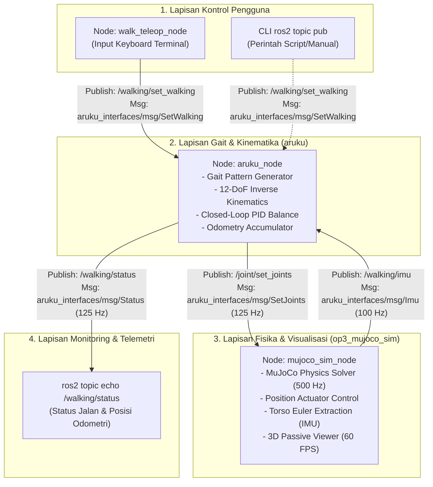

# Simulasi Berjalan Robot Humanoid Hiro - MuJoCo & ROS 2 Jazzy

Repositori ini difokuskan **khusus untuk konsep, kontrol lokomosi, dan implementasi berjalan (*bipedal walking*)** robot humanoid **Hiro Robot** (berbasis arsitektur robot humanoid 20-DOF / OP3-series) menggunakan physics engine **MuJoCo** dan framework **ROS 2 Jazzy Jalisco** (Ubuntu 24.04 LTS).

Arsitektur repositori ini dirancang **minimalis, terisolasi, dan berkinerja tinggi**:
- **Simulasi Stabil & Bersih**: Robot langsung *spawn* dalam posisi berdiri tegak seimbang (*upright stand pose*) di atas lantai tanpa dependensi hardware fisik (Dynamixel SDK, CM740, motion player, dll. sudah dieliminasi).
- **Loop Kontrol Tertutup (*Closed-Loop Gait Control*)**: Dilengkapi dengan feedback sensor IMU (Roll & Pitch) dan algoritma penyeimbang PID (*closed-loop balance*) sehingga robot tahan terhadap osilasi langkah.
- **Modularitas ROS 2**: Komunikasi antar-node terisolasi rapi melalui paket interface kustom (`aruku_interfaces`).

---

## Daftar Isi
1. [Arsitektur & Cara Kerja Proyek](#1-arsitektur--cara-kerja-proyek)
2. [Nodes (Node ROS 2)](#2-nodes-node-ros-2)
3. [Topics (Topik ROS 2 & Protokol Pesan)](#3-topics-topik-ros-2--protokol-pesan)
4. [Services (Layanan ROS 2)](#4-services-layanan-ros-2)
5. [Actions (Aksi ROS 2)](#5-actions-aksi-ros-2)
6. [Contoh Konkret Pemetaan Komunikasi (Pub-Sub & Payload)](#6-contoh-konkret-pemetaan-komunikasi-pub-sub--payload)
7. [Struktur Paket Workspace](#7-struktur-paket-workspace)
8. [Panduan Instalasi & Kompilasi](#8-panduan-instalasi--kompilasi)
   - [8.1 Cara Instalasi ROS 2 Jazzy Polosan (Ubuntu 24.04 LTS)](#81-cara-instalasi-ros-2-jazzy-polosan-ubuntu-2404-lts)
   - [8.2 Panduan Instalasi Physics Engine MuJoCo](#82-panduan-instalasi-physics-engine-mujoco)
   - [8.3 Cara Membuat Workspace ROS 2 Polosan](#83-cara-membuat-workspace-ros-2-polosan)
   - [8.4 Template Folder & Proyek Contoh: Simple Publisher & Subscriber (C++)](#84-template-folder--proyek-contoh-simple-publisher--subscriber-c)
   - [8.5 Instalasi Dependensi & Kompilasi Proyek Ini (mujoco-op3)](#85-instalasi-dependensi--kompilasi-proyek-ini-mujoco-op3)
9. [Panduan Menjalankan Simulasi & Kontrol](#9-panduan-menjalankan-simulasi--kontrol)
10. [Konfigurasi Kinematika & Gait Tuning](#10-konfigurasi-kinematika--gait-tuning)
11. [Debugging & Inspeksi Sistem](#11-debugging--inspeksi-sistem)

---

## 1. Arsitektur & Cara Kerja Proyek

Sistem ini bekerja berdasarkan konsep **Closed-Loop Bipedal Locomotion Framework**. Secara garis besar, terdapat 3 proses utama yang saling terhubung:
1. **User Input / Velocity Command**: Pengguna memberikan perintah gerak (*gait request*) berupa kecepatan translasi maju-mundur ($X$), menyamping ($Y$), atau putaran sudut ($Yaw/\alpha$).
2. **Gait Generation & Inverse Kinematics (`aruku`)**: Walking engine menghitung trajectory lintasan kaki (fase menapak / *stance* dan fase mengayun / *swing*), menghitung sudut sendi yang dibutuhkan menggunakan *Inverse Kinematics (IK)* 12 sendi kaki, serta mengoreksi sudut tersebut menggunakan umpan balik orientasi dari sensor IMU melalui kontroler PID.
3. **Physics Simulation & Sensor Simulation (`op3_mujoco_sim`)**: Engine MuJoCo menerima sudut target sendi, menerapkan torsi motor servo menggunakan model aktuator posisi, mengeksekusi dinamika kontak telapak kaki dengan lantai pada frekuensi 500 Hz, dan mengembalikan data orientasi torso ke walking engine.

### Diagram Alur Data Sistem



### Tahapan Siklus Kontrol Berjalan (*Control Loop Life-Cycle*)
1. **Inisialisasi & Proteksi Berdiri**:
   - `mujoco_sim_node` memuat model robot dari file XML MJCF (`scene.xml` dan `robot.xml`).
   - Robot langsung diposisikan berdiri tegak di atas lantai dengan sudut servo awal (*standing pose*) yang dibaca dari `init_angles` pada file [walking.json](file:///home/joshua/Documents/Projek%20ROS%202/mujoco-op3/src/aruku/config/walking.json).
   - Node simulator memiliki mekanisme deteksi *heartbeat* (`is_aruku_alive`). Sebelum `aruku_node` aktif, robot dikunci pada posisi berdiri kokoh dan gaya luar (seperti tarikan mouse) dinonaktifkan agar robot tidak terjatuh.
2. **Penerimaan Instruksi Gerak**:
   - Operator menekan tombol (misal `W` untuk maju) pada `walk_teleop`. Node mempublikasikan pesan `SetWalking` ke topik `/walking/set_walking` dengan nilai `run = true` dan `x_move = 10.0` mm.
3. **Pembangkitan Pola Langkah (*Gait Generation*)**:
   - `aruku_node` menerima pesan tersebut pada callback `set_walking_subscriber`.
   - Timer 8 ms (125 Hz) pada `aruku_node` memicu `walking_manager->process()`.
   - Algoritma kinematika membagi langkah ke dalam fase: *Double Support Phase* (kedua kaki menapak) dan *Single Support Phase* (satu kaki mengayun, satu kaki menahan beban badan).
4. **Koreksi Keseimbangan Loop Tertutup (*Closed-Loop Balancing*)**:
   - `aruku_node` menerima pembacaan sudut torso dari simulator via topik `/walking/imu`.
   - Kontroler PID membandingkan sudut roll dan pitch aktual torso terhadap target nol derajat. Jika terdeteksi kemiringan (error), PID menghasilkan kompensasi offset sudut pada sendi pinggul (*hip*) dan pergelangan kaki (*ankle*) untuk menjaga stabilitas.
5. **Eksekusi Fisika di MuJoCo**:
   - `aruku_node` mengirimkan seluruh sudut sendi hasil kalkulasi (dalam derajat) ke `/joint/set_joints`.
   - `mujoco_sim_node` menerima array sendi, mencocokkan ID servo ke mapping sendi (`SERVO_MAP`), mengonversinya dari derajat ke radian dengan tanda arah (*sign*), dan menyetorkannya ke buffer aktuator MuJoCo `data.ctrl`.
   - Solver fisika MuJoCo mengeksekusi dinamika multi-body, gesekan kontak kaki, dan gravitasi secara real-time.

---

## 2. Nodes (Node ROS 2)

Proyek ini memiliki **3 node aktif**:

| Nama Node | Paket ROS 2 | File Sumber / Executable | Bahasa | Frekuensi Eksekusi | Peran & Tanggung Jawab Utama |
| :--- | :--- | :--- | :--- | :--- | :--- |
| **`mujoco_sim_node`** | `op3_mujoco_sim` | [mujoco_sim_node.py](file:///home/joshua/Documents/Projek%20ROS%202/mujoco-op3/src/op3_mujoco_sim/op3_mujoco_sim/mujoco_sim_node.py)<br>`sim_node` | Python / C-Binding | 500 Hz (Fisika)<br>100 Hz (IMU)<br>60 Hz (GUI) | Mengelola simulasi fisika MuJoCo, visualisasi 3D, parsing model MJCF, mengeksekusi target posisi sendi, dan mengekstraksi orientasi torso badan (IMU). |
| **`aruku_node`** | `aruku` | [aruku_main.cpp](file:///home/joshua/Documents/Projek%20ROS%202/mujoco-op3/src/aruku/src/aruku_main.cpp)<br>`main` | C++17 | 125 Hz (Timer 8 ms) | Otak berjalan robot (*Gait Engine*). Menghitung invers kinematika 12 sendi kaki, trajektori langkah kaki bipedal, kompensasi keseimbangan PID, dan odometri pergerakan. |
| **`walk_teleop_node`** | `op3_mujoco_sim` | [walk_teleop.py](file:///home/joshua/Documents/Projek%20ROS%202/mujoco-op3/src/op3_mujoco_sim/op3_mujoco_sim/walk_teleop.py)<br>`walk_teleop` | Python | Event-driven (Polling keyboard non-blocking 10 Hz) | Antarmuka pengguna berbasis terminal keyboard untuk mengirim perintah jalan (Maju, Mundur, Putar, Geser, Berhenti) ke walking engine. |

---

## 3. Topics (Topik ROS 2 & Protokol Pesan)

Seluruh komunikasi antar-node berjalan secara asinkronus menggunakan topik ROS 2 dan tipe pesan dari paket [aruku_interfaces](file:///home/joshua/Documents/Projek%20ROS%202/mujoco-op3/src/aruku_interfaces).

### Ringkasan Tabel Topik

| Nama Topik | Tipe Pesan | Publisher | Subscriber | Frekuensi | Deskripsi |
| :--- | :--- | :--- | :--- | :--- | :--- |
| **`/walking/set_walking`** | `aruku_interfaces/msg/SetWalking` | `walk_teleop_node` (atau CLI pengguna) | `aruku_node` | Event-driven (saat tombol ditekan) | Mengirim perintah parameter langkah: status aktif/berhenti, kecepatan langkah X, Y, dan rotasi $\alpha$. |
| **`/joint/set_joints`** | `aruku_interfaces/msg/SetJoints` | `aruku_node` | `mujoco_sim_node` | ~125 Hz | Mengirim target sudut posisi sendi (derajat) hasil kalkulasi invers kinematika ke aktuator simulator. |
| **`/walking/imu`** | `aruku_interfaces/msg/Imu` | `mujoco_sim_node` | `aruku_node` | 100 Hz | Mengirim data orientasi torso robot (Roll, Pitch, Yaw dalam derajat) dari simulator ke walking engine. |
| **`/walking/status`** | `aruku_interfaces/msg/Status` | `aruku_node` | CLI pengguna (`ros2 topic echo`) | ~125 Hz | Mempublikasikan status berjalan robot, amplitudo langkah yang sedang aktif, dan estimasi akumulasi posisi odometri ($X, Y$). |

---

### Detail Struktur & Definisi Message (`aruku_interfaces`)

#### 1. `aruku_interfaces/msg/SetWalking`
Digunakan untuk mengontrol mode berjalan robot:
```text
bool run true       # true: robot melangkah; false: robot berhenti dan kembali ke pose berdiri tegak
float64 x_move 0.0  # Panjang langkah maju (+) atau mundur (-) dalam satuan mm (milimeter)
float64 y_move 0.0  # Panjang langkah geser menyamping (strafe): kiri (+) atau kanan (-) dalam satuan mm
float64 a_move 0.0  # Sudut rotasi belok: kiri (+) atau kanan (-) dalam satuan derajat
bool aim_on false   # Mode pelacakan/aiming target (default: false)
```

#### 2. `aruku_interfaces/msg/SetJoints` & `Joint`
Digunakan untuk mengirim perintah posisi sudut sendi ke simulator:
- **`SetJoints.msg`**:
  ```text
  Joint[] joints    # Kumpulan array objek sendi yang akan diperbarui posisinya
  ```
- **`Joint.msg`**:
  ```text
  uint8 id          # Nomor ID servo (1 s.d. 20 sesuai standar konvensi robot OP3/Hiro)
  float32 position  # Target sudut sendi dalam satuan DERAJAT (degrees)
  ```

#### 3. `aruku_interfaces/msg/Imu`
Digunakan untuk menyediakan orientasi badan robot:
```text
float64 roll   # Sudut kemiringan badan ke samping (kiri/kanan) dalam satuan DERAJAT
float64 pitch  # Sudut kemiringan badan ke depan/belakang dalam satuan DERAJAT
float64 yaw    # Sudut hadap/rotasi arah badan terhadap sumbu vertikal dalam satuan DERAJAT
```

#### 4. `aruku_interfaces/msg/Status` & `Point2`
Digunakan untuk memantau status gait dan odometri robot:
- **`Status.msg`**:
  ```text
  bool is_running       # Status berjalan (true: sedang melangkah, false: diam berdiri)
  float64 x_amplitude   # Amplitudo langkah sumbu X aktual (mm)
  float64 y_amplitude   # Amplitudo langkah sumbu Y aktual (mm)
  float64 a_amplitude   # Amplitudo langkah belok aktual (derajat)
  Point2 odometry       # Akumulasi posisi perpindahan robot (X, Y)
  ```
- **`Point2.msg`**:
  ```text
  float64 x 0.0         # Koordinat posisi X akumulatif (cm / satuan walking manager)
  float64 y 0.0         # Koordinat posisi Y akumulatif
  ```

#### 5. `aruku_interfaces/msg/WalkPhase`
Digunakan di level internal walking engine sebagai konstanta fase langkah bipedal:
```text
uint8 DOUBLE_SUPPORT = 0   # Fase tumpuan ganda (kedua telapak kaki menapak di tanah)
uint8 RIGHT_SUPPORT  = 1   # Kaki kanan menumpu badan, kaki kiri melayang di udara
uint8 LEFT_SUPPORT   = 2   # Kaki kiri menumpu badan, kaki kanan melayang di udara

uint8 current              # Nilai fase saat ini
```

---

## 4. Services (Layanan ROS 2)

### Mengapa Tidak Ada Custom Service untuk Kendali Berjalan?
Pada proyek ini, **tidak terdapat custom ROS 2 Service (`.srv`)** yang dibuat khusus untuk kontrol langkah. Hal ini merupakan **keputusan arsitektur yang disengaja**:
- **Karakteristik Service di ROS 2**: Bersifat *synchronous Request-Response* (Remote Procedure Call / RPC). Ketika sebuah node memanggil service, thread biasanya terblokir (*blocking*) hingga node server memberikan balasan.
- **Karakteristik Lokomosi Robot Humanoid**: Berjalan dinamis bipedal membutuhkan aliran data berkelanjutan (*continuous high-frequency data streaming*) pada frekuensi tinggi (100–125 Hz). Jika sudut sendi atau data sensor dikirim melalui Service, komunikasi akan mengalami latensi, pemblokiran thread proses fisika, dan berisiko menyebabkan simulator tidak tepat waktu (*frame drop*), yang berakibat robot langsung terjatuh.
- Oleh karena itu, pola **Publish-Subscribe (Topik)** adalah standar industri robotika untuk mengirimkan target aktuasi dan data sensor frekuensi tinggi.

### Built-in ROS 2 Parameter Services
Meskipun tidak memiliki custom service untuk gerak, **setiap node ROS 2 di proyek ini secara otomatis menyediakan built-in parameter services** dari arsitektur ROS 2:
- `/<node_name>/describe_parameters` (`rcl_interfaces/srv/DescribeParameters`)
- `/<node_name>/get_parameters` (`rcl_interfaces/srv/GetParameters`)
- `/<node_name>/set_parameters` (`rcl_interfaces/srv/SetParameters`)
- `/<node_name>/list_parameters` (`rcl_interfaces/srv/ListParameters`)

#### Contoh Penggunaan Built-in Services
Anda dapat menginspeksi atau mengubah konfigurasi node saat runtime menggunakan CLI ROS 2:
```bash
# 1. Melihat daftar seluruh service yang aktif pada node simulasi
ros2 service list | grep mujoco_sim_node

# 2. Mengambil parameter model_path pada node simulator
ros2 service call /mujoco_sim_node/get_parameters rcl_interfaces/srv/GetParameters "{names: ['use_gui', 'imu_rate']}"

# 3. Atau melalui perintah praktis ROS 2 parameter:
ros2 param get /mujoco_sim_node imu_rate
```

---

## 5. Actions (Aksi ROS 2)

### Status Action di Proyek Ini
Pada proyek ini, **belum diimplementasikan ROS 2 Action (`.action`) kustom**. 

### Alasan Teknis
1. Kontrol saat ini beroperasi pada level **Velocity / Gait Direct Control** (mirip perintah `cmd_vel` pada robot beroda): operator atau planner luar secara dinamis terus mengontrol kecepatan langkah ($x\_move, y\_move, a\_move$) secara real-time.
2. ROS 2 Action dirancang untuk **tugas berorientasi tujuan jangka panjang (*Goal-Oriented Long-Running Tasks*)** yang dapat dibatalkan (*preemptable*) dan memberikan status kemajuan (*feedback* berkala) hingga mencapai hasil akhir (*result*).

### Konsep Desain Jika Action Diimplementasikan di Masa Depan
Jika Anda ingin mengembangkan sistem navigasi otonom pada robot ini (misalnya integrasi Nav2 atau behavior tree), dapat dibuat sebuah Action kustom (contoh: `aruku_interfaces/action/WalkToDistance.action`):

```text
# === GOAL (Tujuan) ===
float64 target_distance_x    # Contoh: Berjalan maju sejauh 1.5 meter
float64 target_distance_y    # Contoh: Geser ke samping 0.0 meter
float64 target_angle         # Contoh: Belok menghadap 90 derajat
---
# === RESULT (Hasil Akhir) ===
bool success                 # true jika target tercapai dengan selamat
float64 final_distance_x     # Posisi akhir odometri X
string message               # Pesan status (misal: "Goal reached" atau "Robot fell down")
---
# === FEEDBACK (Umpan Balik Berkala) ===
float64 remaining_distance   # Jarak yang tersisa menuju tujuan
uint8 current_walk_phase     # Fase langkah saat ini (DOUBLE_SUPPORT / SINGLE_SUPPORT)
float64 current_pitch_error  # Indikator stabilitas keseimbangan robot
```

---

## 6. Contoh Konkret Pemetaan Komunikasi (Pub-Sub & Payload)

Berikut adalah detail lengkap pemetaan komunikasi: siapa yang mem-publish, siapa yang men-subscribe, nama topik, tipe pesan, dan contoh isi payload datanya.

### Contoh 1: Input Berjalan Pengguna
- **Publisher**: `walk_teleop_node` (atau CLI `ros2 topic pub`)
- **Subscriber**: `aruku_node`
- **Topik**: `/walking/set_walking`
- **Tipe Pesan**: `aruku_interfaces/msg/SetWalking`
- **Contoh Payload (Maju ke Depan dengan Kecepatan 15 mm/langkah)**:
  ```yaml
  run: true
  x_move: 15.0
  y_move: 0.0
  a_move: 0.0
  aim_on: false
  ```
- **Contoh Payload (Berputar di Tempat ke Kiri 10 derajat/langkah)**:
  ```yaml
  run: true
  x_move: 0.0
  y_move: 0.0
  a_move: 10.0
  aim_on: false
  ```
- **Contoh Payload (Berhenti dan Tegak Diam)**:
  ```yaml
  run: false
  x_move: 0.0
  y_move: 0.0
  a_move: 0.0
  aim_on: false
  ```

---

### Contoh 2: Perintah Sudut Sendi (*Joint Angles*)
- **Publisher**: `aruku_node`
- **Subscriber**: `mujoco_sim_node`
- **Topik**: `/joint/set_joints`
- **Tipe Pesan**: `aruku_interfaces/msg/SetJoints`
- **Deskripsi**: `aruku_node` menghitung sudut 12 sendi kaki dan 6 sendi lengan setiap 8 ms (125 Hz). Pesan berisi kumpulan ID servo dan target posisinya dalam satuan derajat.
- **Contoh Payload Sebagian (Potongan Pesan YAML)**:
  ```yaml
  joints:
    - id: 1
      position: -45.0     # right_shoulder_pitch
    - id: 2
      position: 45.0      # left_shoulder_pitch
    - id: 11
      position: -8.17     # right_hip_pitch
    - id: 12
      position: 8.17      # left_hip_pitch
    - id: 13
      position: 17.93     # right_knee
    - id: 14
      position: -17.93    # left_knee
    - id: 15
      position: 9.76      # right_ankle_pitch
    - id: 16
      position: -9.76     # left_ankle_pitch
  ```
- **Penanganan di Subscriber (`mujoco_sim_node`)**:
  Simulator memetakan ID ke nama joint MuJoCo dan mengalikan sudut dengan faktor konversi derajat ke radian dan arah rotasi (`SERVO_MAP`):
  $$\theta_{\text{MuJoCo}} = \text{radians}(\text{position}) \times \text{sign}$$

#### Daftar Pemetaan ID Servo ke MuJoCo Actuator
| ID Servo | Nama Joint di MuJoCo | Arah (*Sign*) | Bagian Tubuh |
| :---: | :--- | :---: | :--- |
| **1** | `right_shoulder_pitch` | -1.0 | Lengan Kanan |
| **2** | `left_shoulder_pitch` | +1.0 | Lengan Kiri |
| **3** | `right_shoulder_roll` | -1.0 | Lengan Kanan |
| **4** | `left_shoulder_roll` | +1.0 | Lengan Kiri |
| **5** | `right_elbow` | -1.0 | Siku Kanan |
| **6** | `left_elbow` | -1.0 | Siku Kiri |
| **7** | `right_hip_yaw` | -1.0 | Kaki Kanan (Pinggul Yaw) |
| **8** | `left_hip_yaw` | -1.0 | Kaki Kiri (Pinggul Yaw) |
| **9** | `right_hip_roll` | -1.0 | Kaki Kanan (Pinggul Roll) |
| **10** | `left_hip_roll` | -1.0 | Kaki Kiri (Pinggul Roll) |
| **11** | `right_hip_pitch` | +1.0 | Kaki Kanan (Paha Pitch) |
| **12** | `left_hip_pitch` | -1.0 | Kaki Kiri (Paha Pitch) |
| **13** | `right_knee` | +1.0 | Lutut Kanan |
| **14** | `left_knee` | -1.0 | Lutut Kiri |
| **15** | `right_ankle_pitch` | -1.0 | Pergelangan Kaki Kanan (Pitch) |
| **16** | `left_ankle_pitch` | +1.0 | Pergelangan Kaki Kiri (Pitch) |
| **17** | `right_ankle_roll` | +1.0 | Pergelangan Kaki Kanan (Roll) |
| **18** | `left_ankle_roll` | +1.0 | Pergelangan Kaki Kiri (Roll) |
| **19** | `neck_yaw` | +1.0 | Kepala (Yaw) |
| **20** | `neck_pitch` | +1.0 | Kepala (Pitch) |

---

### Contoh 3: Feedback Sensor IMU Torso
- **Publisher**: `mujoco_sim_node`
- **Subscriber**: `aruku_node`
- **Topik**: `/walking/imu`
- **Tipe Pesan**: `aruku_interfaces/msg/Imu`
- **Deskripsi**: Dihitung dari matriks rotasi torso (`xmat` pada `torso_kidsize25`) di MuJoCo setiap 10 ms (100 Hz).
- **Contoh Payload**:
  ```yaml
  roll: 0.12        # Badan miring ke kanan 0.12 derajat
  pitch: -1.45      # Badan condong ke depan 1.45 derajat
  yaw: 0.05         # Orientasi hadap robot relatif terhadap start
  ```
- **Penanganan di Subscriber (`aruku_node`)**:
  Nilai `roll` dan `pitch` dimasukkan ke kontroler PID penyeimbang (`WalkingManager::update_imu`). Jika `pitch` negatif (condong ke depan), PID akan menambahkan offset pada sendi ankle dan hip untuk menegakkan kembali robot saat berjalan.

---

### Contoh 4: Pemantauan Status & Odometri
- **Publisher**: `aruku_node`
- **Subscriber**: Monitoring CLI / User (`ros2 topic echo /walking/status`)
- **Topik**: `/walking/status`
- **Tipe Pesan**: `aruku_interfaces/msg/Status`
- **Contoh Payload**:
  ```yaml
  is_running: true
  x_amplitude: 15.0
  y_amplitude: 0.0
  a_amplitude: 0.0
  odometry:
    x: 84.62
    y: 0.14
  ```

---

## 7. Struktur Paket Workspace

Workspace ini terbagi menjadi 4 paket utama:

```text
mujoco-op3/
├── src/
│   ├── op3_mujoco_sim/       # Simulasi fisika MuJoCo 3D (Hiro Robot) + teleop berjalan
│   │   ├── config/           # File parameter simulasi (sim_params.yaml)
│   │   ├── launch/           # sim.launch.py (launch file simulasi)
│   │   ├── models/           # File MJCF scene.xml, robot.xml, dan file mesh 3D (.stl)
│   │   └── op3_mujoco_sim/   # Kode sumber Python (mujoco_sim_node.py & walk_teleop.py)
│   │
│   ├── aruku/                # Walking engine humanoid (Inverse Kinematics, ZMP, PID Balance)
│   │   ├── config/           # Parameter jalan: walking.json & kinematic.json
│   │   ├── include/          # Header C++ (kinematics, walking node, joint model)
│   │   └── src/              # Implementasi gait generator & node ROS 2 (aruku_main.cpp)
│   │
│   ├── aruku_interfaces/     # Definisi interface pesan (msg) kustom ROS 2
│   │   └── msg/              # SetWalking.msg, SetJoints.msg, Imu.msg, Status.msg, dll.
│   │
│   └── keisan/               # Library utilitas matematika C++ (vektor, matriks, sudut, kalman)
└── README.md                 # Dokumentasi utama proyek
```

---

## 8. Panduan Instalasi & Kompilasi

### 8.1 Cara Instalasi ROS 2 Jazzy Polosan (Ubuntu 24.04 LTS)

Jika sistem Ubuntu 24.04 LTS Anda belum terpasang ROS 2 Jazzy, berikut adalah langkah instalasi resmi ROS 2 Jazzy Jalisco dari repositori Debian resmi (*fresh install*):

#### 1. Pengaturan Locale Sistem
Pastikan sistem Anda menggunakan locale dengan dukungan UTF-8:
```bash
sudo apt update && sudo apt install locales -y
sudo locale-gen en_US en_US.UTF-8
sudo update-locale LC_ALL=en_US.UTF-8 LANG=en_US.UTF-8
export LANG=en_US.UTF-8
```

#### 2. Konfigurasi Repositori & Kunci GPG
Aktifkan repositori Universe Ubuntu, lalu tambahkan GPG key resmi ROS 2:
```bash
# Aktifkan repositori Universe Ubuntu
sudo apt install software-properties-common curl -y
sudo add-apt-repository universe -y

# Tambahkan GPG key resmi ROS 2
sudo curl -sSL https://raw.githubusercontent.com/ros/rosdistro/master/ros.key -o /usr/share/keyrings/ros-archive-keyring.gpg

# Daftarkan repositori ROS 2 ke APT sources list
echo "deb [arch=$(dpkg --print-architecture) signed-by=/usr/share/keyrings/ros-archive-keyring.gpg] http://packages.ros.org/ros2/ubuntu $(. /etc/os-release && echo $UBUNTU_CODENAME) main" | sudo tee /etc/apt/sources.list.d/ros2.list > /dev/null
```

#### 3. Instalasi Paket ROS 2 Jazzy
Perbarui indeks paket APT dan instal paket yang diinginkan:
```bash
sudo apt update

# Rekomendasi: Desktop Install (ROS 2, RViz, demo, dan tutorial)
sudo apt install -y ros-jazzy-desktop

# Opsi Minimalis / Base (Khusus server / komputer robot tanpa GUI):
# sudo apt install -y ros-jazzy-ros-base
```

#### 4. Instalasi Alat Pengembangan (Colcon, Rosdep & Build Tools)
```bash
sudo apt install -y python3-colcon-common-extensions python3-rosdep build-essential git
```

#### 5. Inisialisasi Rosdep
```bash
sudo rosdep init
rosdep update
```

#### 6. Sourcing Environment ROS 2
```bash
source /opt/ros/jazzy/setup.bash

# (Opsional) Tambahkan ke ~/.bashrc agar otomatis aktif pada terminal baru:
echo "source /opt/ros/jazzy/setup.bash" >> ~/.bashrc
```

---

### 8.2 Panduan Instalasi Physics Engine MuJoCo

MuJoCo (*Multi-Joint dynamics with Contact*) adalah physics engine berkinerja tinggi yang digunakan untuk simulasi fisika robot humanoid ini. Untuk memasang dan mengonfigurasinya pada Ubuntu 24.04 LTS:

#### 1. Instalasi Pustaka Dependensi Grafis & OpenGL
MuJoCo viewer memerlukan pustaka OpenGL dan GLFW untuk me-render simulasi 3D di layar:
```bash
sudo apt update && sudo apt install -y \
  libgl1-mesa-dev \
  libgl1-mesa-glx \
  libglew-dev \
  libglfw3-dev
```

#### 2. Instalasi Paket Python MuJoCo & NumPy
Instal modul Python resmi `mujoco` dan `numpy`:
```bash
pip3 install mujoco numpy --break-system-packages
```
> [!NOTE]
> Pada Ubuntu 24.04 LTS (Noble Numbat), standar PEP 668 diterapkan secara default untuk menjaga integritas file sistem. Opsi `--break-system-packages` memungkinkan instalasi pip lokal pengguna tanpa merusak paket APT sistem jika Anda tidak menggunakan virtual environment Python (venv).

#### 3. Verifikasi Instalasi MuJoCo
Pastikan modul `mujoco` berhasil diimpor dan periksa versinya:
```bash
python3 -c "import mujoco; print('MuJoCo version:', mujoco.__version__)"
```

#### 4. Uji Visualizer 3D MuJoCo
Jalankan viewer interaktif bawaan MuJoCo untuk memastikan driver GPU dan display server (X11 / Wayland) bekerja normal:
```bash
python3 -m mujoco.viewer
```
*(Jendela viewer 3D interaktif MuJoCo akan muncul. Tekan `ESC` untuk keluar)*.

---

### 8.3 Cara Membuat Workspace ROS 2 Polosan

Hierarki workspace ROS 2 standar terdiri dari 4 direktori utama:
```text
ros2_ws/                        # Direktori root workspace
├── src/                        # [DIKERJAKAN MANUAL] Tempat seluruh kode sumber dan paket ROS 2
├── build/                      # [DIHASILKAN COLCON] Cache dan file objek kompilasi
├── install/                    # [DIHASILKAN COLCON] Output biner executable dan skrip environment
│   ├── setup.bash              # Skrip sourcing seluruh environment workspace
│   └── local_setup.bash        # Skrip sourcing khusus paket dalam workspace ini
└── log/                        # [DIHASILKAN COLCON] Catatan riwayat log proses build
```

Langkah membuat workspace kosong dari awal:
```bash
# 1. Buat direktori workspace dan sub-folder src
mkdir -p ~/ros2_ws/src
cd ~/ros2_ws

# 2. Build awal untuk membentuk struktur direktori build, install, dan log
colcon build

# 3. Source hasil build workspace lokal
source install/setup.bash
```

---

### 8.4 Template Folder & Proyek Contoh: Simple Publisher & Subscriber (C++)

Pola komunikasi paling mendasar di ROS 2 adalah **Publisher-Subscriber** melalui sebuah Topic. Di bawah ini adalah panduan lengkap pembuatan template proyek **C++ (`ament_cmake`)** bernama `cpp_pubsub` yang mengimplementasikan node *Talker* (Publisher) dan node *Listener* (Subscriber) menggunakan tipe pesan standar `std_msgs/msg/String` pada topik `/chatter`.

---

#### 1. Perintah Pembuatan Paket C++
Buka terminal, masuk ke folder `src/` pada workspace ROS 2, lalu buat paket baru dengan dependensi `rclcpp` dan `std_msgs`:
```bash
cd ~/ros2_ws/src
ros2 pkg create --build-type ament_cmake cpp_pubsub --dependencies rclcpp std_msgs
```

---

#### 2. Struktur Hierarki Folder Paket `cpp_pubsub`
Struktur direktori paket template C++ setelah file kode sumber dan konfigurasi ditambahkan:
```text
cpp_pubsub/
├── CMakeLists.txt                        # Konfigurasi build CMake & pendaftaran target executable
├── package.xml                           # Metadata paket, lisensi, & dependensi ROS 2
├── include/
│   └── cpp_pubsub/                       # Direktori header C++ (.hpp / .h jika diperlukan)
├── src/
│   ├── publisher_member_function.cpp     # Kode sumber Node Publisher (Talker C++)
│   └── subscriber_member_function.cpp    # Kode sumber Node Subscriber (Listener C++)
└── launch/                               # (Opsional) File peluncur multi-node
    └── pubsub.launch.py                  # Launch file untuk menjalankan talker & listener sekaligus
```

---

#### 3. Kode Sumber Publisher Node: `src/publisher_member_function.cpp`
Node ini bertugas mempublikasikan string pesan `"Hello, world! <nomor>"` ke topik `/chatter` secara berkala (setiap 500 ms / 2 Hz):

```cpp
#include <chrono>
#include <memory>
#include <string>

#include "rclcpp/rclcpp.hpp"
#include "std_msgs/msg/string.hpp"

using namespace std::chrono_literals;

/* Node Publisher turunan dari rclcpp::Node */
class MinimalPublisher : public rclcpp::Node
{
public:
  MinimalPublisher()
  : Node("minimal_publisher"), count_(0)
  {
    // Membuat publisher pada topik "chatter" dengan antrean (QoS history depth) 10
    publisher_ = this->create_publisher<std_msgs::msg::String>("chatter", 10);

    // Timer memicu pengiriman pesan setiap 500 ms (2 Hz)
    timer_ = this->create_wall_timer(
      500ms, std::bind(&MinimalPublisher::timer_callback, this));

    RCLCPP_INFO(this->get_logger(), "Node Publisher C++ telah aktif!");
  }

private:
  void timer_callback()
  {
    auto message = std_msgs::msg::String();
    message.data = "Hello, world! " + std::to_string(count_++);
    RCLCPP_INFO(this->get_logger(), "Publishing: '%s'", message.data.c_str());
    publisher_->publish(message);
  }

  rclcpp::TimerBase::SharedPtr timer_;
  rclcpp::Publisher<std_msgs::msg::String>::SharedPtr publisher_;
  size_t count_;
};

int main(int argc, char * argv[])
{
  rclcpp::init(argc, argv);
  rclcpp::spin(std::make_shared<MinimalPublisher>());
  rclcpp::shutdown();
  return 0;
}
```

---

#### 4. Kode Sumber Subscriber Node: `src/subscriber_member_function.cpp`
Node ini berlangganan (*subscribe*) ke topik `/chatter` dan menampilkan pesan yang diterima di terminal:

```cpp
#include <memory>

#include "rclcpp/rclcpp.hpp"
#include "std_msgs/msg/string.hpp"

/* Node Subscriber turunan dari rclcpp::Node */
class MinimalSubscriber : public rclcpp::Node
{
public:
  MinimalSubscriber()
  : Node("minimal_subscriber")
  {
    // Berlangganan topik "chatter" dengan callback topic_callback
    subscription_ = this->create_subscription<std_msgs::msg::String>(
      "chatter", 10,
      std::bind(&MinimalSubscriber::topic_callback, this, std::placeholders::_1));

    RCLCPP_INFO(this->get_logger(), "Node Subscriber C++ telah aktif dan menunggu data...");
  }

private:
  void topic_callback(const std_msgs::msg::String & msg) const
  {
    RCLCPP_INFO(this->get_logger(), "I heard: '%s'", msg.data.c_str());
  }

  rclcpp::Subscription<std_msgs::msg::String>::SharedPtr subscription_;
};

int main(int argc, char * argv[])
{
  rclcpp::init(argc, argv);
  rclcpp::spin(std::make_shared<MinimalSubscriber>());
  rclcpp::shutdown();
  return 0;
}
```

---

#### 5. Konfigurasi `CMakeLists.txt`
Konfigurasikan file `CMakeLists.txt` untuk mengompilasi kedua file sumber menjadi executable `talker` dan `listener`:

```cmake
cmake_minimum_required(VERSION 3.8)
project(cpp_pubsub)

if(CMAKE_COMPILER_IS_GNUCXX OR CMAKE_CXX_COMPILER_ID MATCHES "Clang")
  add_compile_options(-Wall -Wextra -Wpedantic)
endif()

# Temukan paket dependensi ROS 2
find_package(ament_cmake REQUIRED)
find_package(rclcpp REQUIRED)
find_package(std_msgs REQUIRED)

# 1. Target Executable Publisher (talker)
add_executable(talker src/publisher_member_function.cpp)
ament_target_dependencies(talker rclcpp std_msgs)

# 2. Target Executable Subscriber (listener)
add_executable(listener src/subscriber_member_function.cpp)
ament_target_dependencies(listener rclcpp std_msgs)

# Pemasangan executable ke direktori lib paket
install(TARGETS
  talker
  listener
  DESTINATION lib/${PROJECT_NAME}
)

# Pemasangan folder launch (opsional jika menyediakan launch file)
if(EXISTS "${CMAKE_CURRENT_SOURCE_DIR}/launch")
  install(DIRECTORY launch
    DESTINATION share/${PROJECT_NAME}
  )
endif()

ament_package()
```

---

#### 6. Konfigurasi `package.xml`
Pastikan deklarasi dependensi `rclcpp` dan `std_msgs` sudah tercantum:

```xml
<?xml version="1.0"?>
<?xml-model href="http://download.ros.org/schema/package_format3.xsd" schematypens="http://www.w3.org/2001/XMLSchema"?>
<package format="3">
  <name>cpp_pubsub</name>
  <version>0.0.1</version>
  <description>Contoh sederhana Publisher dan Subscriber ROS 2 Jazzy (C++)</description>
  <maintainer email="user@todo.todo">User</maintainer>
  <license>Apache-2.0</license>

  <buildtool_depend>ament_cmake</buildtool_depend>
  <depend>rclcpp</depend>
  <depend>std_msgs</depend>

  <test_depend>ament_lint_auto</test_depend>
  <test_depend>ament_lint_common</test_depend>

  <export>
    <build_type>ament_cmake</build_type>
  </export>
</package>
```

---

#### 7. File Launch Bersama (Opsional): `launch/pubsub.launch.py`
Untuk menyalakan node publisher dan subscriber sekaligus dengan satu perintah:

```python
from launch import LaunchDescription
from launch_ros.actions import Node


def generate_launch_description():
    return LaunchDescription([
        Node(
            package='cpp_pubsub',
            executable='talker',
            name='talker',
            output='screen',
        ),
        Node(
            package='cpp_pubsub',
            executable='listener',
            name='listener',
            output='screen',
        ),
    ])
```

---

#### 8. Kompilasi & Menjalankan Node C++

1. **Build Workspace**:
   ```bash
   cd ~/ros2_ws
   colcon build --packages-select cpp_pubsub
   ```

2. **Opsi A: Jalankan Menggunakan Dua Terminal Terpisah**:
   - **Terminal 1 (Publisher / Talker)**:
     ```bash
     source install/setup.bash
     ros2 run cpp_pubsub talker
     ```
   - **Terminal 2 (Subscriber / Listener)**:
     ```bash
     source install/setup.bash
     ros2 run cpp_pubsub listener
     ```

3. **Opsi B: Jalankan Sekaligus Menggunakan Launch File**:
   ```bash
   source install/setup.bash
   ros2 launch cpp_pubsub pubsub.launch.py
   ```

---

### 8.5 Instalasi Dependensi & Kompilasi Proyek Ini (`mujoco-op3`)

Setelah memahami lingkungan ROS 2 dan MuJoCo, berikut adalah instruksi untuk membangun workspace simulasi **mujoco-op3**:

#### 1. Verifikasi Prasyarat MuJoCo & NumPy
Pastikan modul MuJoCo telah terpasang sesuai [Panduan Instalasi MuJoCo](#82-panduan-instalasi-physics-engine-mujoco):
```bash
pip3 install mujoco numpy --break-system-packages
```

#### 2. Resolusi Otomatis Dependensi ROS 2 (Opsional via rosdep)
```bash
cd ~/Documents/projek/mujoco-op3
rosdep install -i --from-path src --rosdistro jazzy -y
```

#### 3. Langkah Kompilasi (Build Workspace)
Buka terminal di root workspace, lakukan sourcing ROS 2 Jazzy, lalu build workspace:

```bash
cd ~/Documents/projek/mujoco-op3
source /opt/ros/jazzy/setup.bash

# Build seluruh paket dengan symlink-install
colcon build --symlink-install
```

#### 4. Sourcing Lingkungan Kerja Lokal
Setelah build selesai dengan sukses, lakukan sourcing direktori `install`:
```bash
source install/setup.bash
```

---

## 9. Panduan Menjalankan Simulasi & Kontrol

Untuk menjalankan sistem secara lengkap, buka **3 tab / terminal terpisah** (pastikan setiap terminal sudah menjalankan `source /opt/ros/jazzy/setup.bash` dan `source install/setup.bash`).

### Langkah 1: Jalankan Simulator MuJoCo (Terminal 1)
```bash
source /opt/ros/jazzy/setup.bash
source install/setup.bash

ros2 launch simulator sim.launch.py
```
> Window 3D MuJoCo Viewer akan terbuka. Robot langsung berdiri tegak seimbang di atas arena dan menunggu perintah dari walking engine.

*(Opsi Headless / tanpa window 3D GUI)*:
```bash
ros2 launch simulator sim.launch.py use_gui:=false
```

---

### Langkah 2: Jalankan Walking Engine Aruku (Terminal 2)
```bash
source /opt/ros/jazzy/setup.bash
source install/setup.bash

ros2 run aruku main
```
> Node `aruku_node` akan memuat konfigurasi dari `src/aruku/config/` dan mulai terhubung dengan simulator via `/joint/set_joints` dan `/walking/imu`.

---

### Langkah 3: Mengontrol Robot Berjalan (Terminal 3)

#### Opsi A: Teleoperasi Keyboard Interaktif (Direkomendasikan)
Jalankan node teleop:
```bash
source /opt/ros/jazzy/setup.bash
source install/setup.bash

ros2 run simulator walk_teleop
```

Gunakan tombol keyboard berikut pada jendela terminal teleop:

| Tombol | Gerakan | Keterangan |
| :---: | :--- | :--- |
| **`W`** | **Maju** | Robot melangkah maju ke depan (+10 mm/step) |
| **`S`** | **Mundur** | Robot melangkah mundur (-10 mm/step) |
| **`A`** | **Putar Kiri** | Robot berputar di tempat ke arah kiri (+10 deg/step) |
| **`D`** | **Putar Kanan** | Robot berputar di tempat ke arah kanan (-10 deg/step) |
| **`Q`** | **Geser Kiri** | Langkah menyamping (*strafe left*, +10 mm/step) |
| **`E`** | **Geser Kanan** | Langkah menyamping (*strafe right*, -10 mm/step) |
| **`Spasi`** / **`X`** | **Berhenti** | Menghentikan langkah dan kembali ke pose berdiri tegak |
| **`Ctrl + C`** | Keluar | Menutup node teleoperasi |

---

#### Opsi B: Mengirim Perintah Topik Langsung via Terminal (CLI)
Anda dapat mengirimkan perintah langsung ke topik `/walking/set_walking`:

- **Jalan Maju (15 mm/step):**
  ```bash
  ros2 topic pub --once /walking/set_walking aruku_interfaces/msg/SetWalking "{run: true, x_move: 15.0, y_move: 0.0, a_move: 0.0}"
  ```

- **Jalan Mundur (-10 mm/step):**
  ```bash
  ros2 topic pub --once /walking/set_walking aruku_interfaces/msg/SetWalking "{run: true, x_move: -10.0, y_move: 0.0, a_move: 0.0}"
  ```

- **Putar di Tempat ke Kiri (10 derajat/step):**
  ```bash
  ros2 topic pub --once /walking/set_walking aruku_interfaces/msg/SetWalking "{run: true, x_move: 0.0, y_move: 0.0, a_move: 10.0}"
  ```

- **Berhenti (Robot Berdiri Tegak Diam):**
  ```bash
  ros2 topic pub --once /walking/set_walking aruku_interfaces/msg/SetWalking "{run: false, x_move: 0.0, y_move: 0.0, a_move: 0.0}"
  ```

---

## 10. Konfigurasi Kinematika & Gait Tuning

Seluruh parameter gerakan robot dapat diatur tanpa perlu mengompilasi ulang kode, melalui dua file JSON pada direktori [src/aruku/config/](file:///home/joshua/Documents/Projek%20ROS%202/mujoco-op3/src/aruku/config/):

### 1. `kinematic.json`
Mengatur parameter dimensi fisik kaki dan trajektori langkah:
- **`length`**:
  - `thigh_length` (138 mm): Panjang segmen paha robot.
  - `calf_length` (138 mm): Panjang segmen betis robot.
  - `ankle_length` (49 mm): Tinggi sendi pergelangan kaki dari telapak kaki.
- **`ratio`**:
  - `period_time` (590 ms): Durasi waktu satu siklus langkah lengkap.
  - `foot_height` (22 mm): Tinggi angkatan kaki di udara saat mengayun (*swing*).
  - `dsp_ratio`: Rasio waktu fase tumpuan ganda (*Double Support Phase*).
  - `move_accel_ratio`: Rasio percepatan transisi kecepatan langkah.
- **`offset`**:
  - `x_offset`, `y_offset`, `z_offset`: Posisi offset awal telapak kaki relatif terhadap pusat pinggul.
  - `pitch_offset`, `hip_pitch_offset`: Offset kemiringan sudut pinggul dan badan saat berdiri.

### 2. `walking.json`
Mengatur kontroler penyeimbang (*Balance Controller*), arah servo, dan odometri:
- **`pid`**:
  - `enable`: Mengaktifkan/menonaktifkan kontroler PID penyeimbang badan.
  - `p_pitch_gain` (1.85), `d_pitch_gain` (0.4): Gain Proporsional dan Derivatif untuk koreksi kemiringan pitch (depan-belakang).
  - `hip_ankle_ratio_pitch` (0.4): Rasio pembagian kompensasi torsi antara sendi pinggul dan pergelangan kaki.
- **`init_angles`**: Sudut pose berdiri default robot untuk setiap sendi (digunakan oleh simulator saat spawn awal).
- **`angles_direction`**: Pengaturan arah putaran motor (+1 atau -1) untuk menyamakan konvensi kinematika dengan model robot.

---

## 11. Debugging & Inspeksi Sistem

Gunakan perintah-perintah berikut untuk memverifikasi kondisi komunikasi ROS 2 saat sistem sedang berjalan:

### 1. Memeriksa Daftar Node yang Aktif
```bash
ros2 node list
```
*Output yang diharapkan:*
```text
/aruku_node
/mujoco_sim_node
/walk_teleop_node
```

### 2. Memeriksa Grafik Komunikasi Node & Topik
```bash
rqt_graph
```
*(Menampilkan diagram visual interaksi node dan topik secara interaktif)*.

### 3. Memantau Frekuensi Pengiriman Topik
```bash
# Cek frekuensi joint (harus sekitar ~125 Hz)
ros2 topic hz /joint/set_joints

# Cek frekuensi IMU (harus sekitar ~100 Hz)
ros2 topic hz /walking/imu
```

### 4. Memantau Nilai Data Topik secara Real-Time
```bash
# Pantau sudut orientasi badan robot
ros2 topic echo /walking/imu

# Pantau status odometri dan amplitudo langkah
ros2 topic echo /walking/status
```
